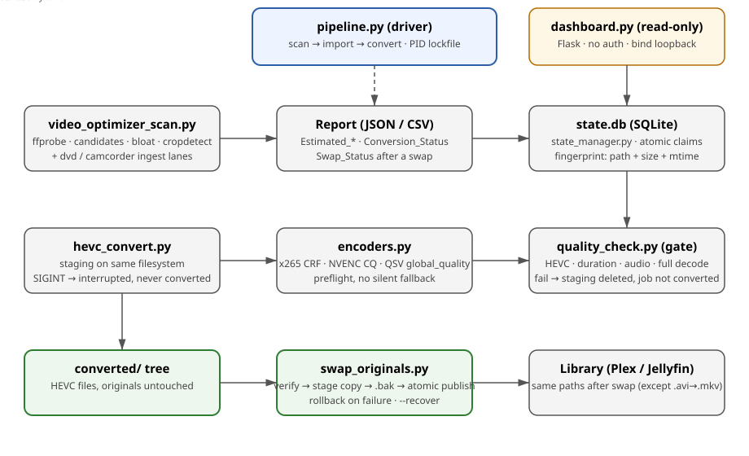

# Video Optimization Pipeline — Inspect → Process → Verify → Replace


## Description

A self-contained Python suite for reclaiming disk space from a large
Plex/Jellyfin library by re-encoding bloated videos to HEVC (H.265) —
without ever touching an original until you explicitly say so, and
without re-encoding anything twice.

The pipeline has four stages, driven by one SQLite state database:

```
scan ──► import ──► convert + verify ──► swap / replace ──► Plex scan
  │         │              │                     │
  ▼         ▼              ▼                     ▼
report   state.db    converted/ tree        original paths,
(JSON)               (HEVC files)           now HEVC, .bak kept
```

`video_optimizer/pipeline.py` is the driver that runs scan → import → convert in one
command. `video_optimizer/dashboard.py` is a read-only view of `state.db` — it does
not feed the pipeline, it watches it.



**Safety model (the whole point of this suite):**

- By default, originals are **never touched**. Encodes go to a
  separate `converted/` tree, and the original stays put.
- Every encode is verified before it is published: HEVC video
  stream, duration match, audio count/codec/channels match, and a
  full decode with no ffmpeg errors. A failed verify deletes the
  staging file and never marks the job converted.
- Replacing an original is opt-in, backed up (`.bak`), atomic
  (`os.replace` on the same filesystem), and rolled back on failure.
- Already-converted files are swapped with `video_optimizer/swap_originals.py`,
  **not** by re-running the converter with `--replace` — that
  re-run selects nothing under `--skip-done` (every row already
  says `converted`) or re-encodes everything under
  `--no-skip-done`. See [Swapping](#swapping-already-converted-files).

**What it handles:** flat video files (the bundled scanner), DVD
title sets (`video_optimizer/dvd_ingest.py`), and legacy camcorder files
(`video_optimizer/camcorder_ingest.py`). Encoders are swappable with one flag:
CPU `libx265` (best compression), NVIDIA NVENC (`hevc_nvenc`),
Intel Quick Sync (`hevc_qsv`). There is no silent fallback — asking
for NVENC/QSV without working hardware fails fast, before any file
is touched.

**Contents:** [Prerequisites](#prerequisites) ·
[Installation](#installation) · [Quickstart](#quickstart) ·
[Local development](#local-development) · [Deployment](#deployment) ·
[Guides](#guides) · [Troubleshooting](#troubleshooting) ·
[Security](#security) · [License](#license)

## Prerequisites

- **Python 3.10+** (3.10–3.12 tested in CI; the Docker image pins 3.12).
- **ffmpeg and ffprobe on PATH**, with `libx265` for CPU encodes.
  The suite shells out to them for every probe, encode, and decode
  check — there is no bundled ffmpeg. Stock Ubuntu ffmpeg has the
  `ssim` filter but no `libvmaf`; the perceptual sample therefore
  uses SSIM on stock builds (advisory only, never a gate).
- **Disk space:** encodes are written *in addition to* the
  originals, and a swap keeps `.bak` backups of every original.
  Budget roughly: originals + converted tree + backups, until you
  delete the `.bak` files after verifying in Plex. The swap script
  refuses to start if the backup drive cannot hold all backups
  plus one staging copy.
- **Optional:** Flask (dashboard only), tqdm (progress bars;
  the code runs without it), exiftool (camcorder metadata merge;
  without it, sidecars are copied next to the output instead).
- **Optional hardware:** an NVIDIA GPU + driver for NVENC, or an
  Intel GPU with `/dev/dri` + the Intel media driver for QSV
  (in Docker, pass the device through — see
  [Deployment](#deployment)). Preflight only proves the ffmpeg
  build knows the encoder; a real encode is the first proof the
  hardware works.
- **Operating systems:** developed on Windows (PowerShell) and
  Linux; the same commands work on both, with `\` vs `/` path
  separators as the only difference. The examples below use
  Linux-style paths; Windows users substitute `reports\...` for
  `reports/...`.

## Installation

The suite is an installable package (`video_optimizer/`, see
`pyproject.toml`). Installing it gives you the short command
names used throughout this README (`video-scan`,
`hevc-convert`, …). The core tools are stdlib-only; Flask
serves the dashboard and tqdm draws progress bars (the code
runs without tqdm), and both come with the install.

```bash
# 1. Get the code (zip extract, or clone the repo)
cd video-optimizer-suite

# 2. (Recommended) a virtual environment, so Flask/tqdm do not
#    leak into your system Python
python -m venv .venv
# Linux/macOS:
source .venv/bin/activate
# Windows PowerShell:
.venv\Scripts\Activate.ps1

# 3. Install the package (editable: code edits take effect at once)
pip install -e .
```

Without an install, every command below also works from the
suite folder as `python -m video_optimizer.<module>` — e.g.
`python -m video_optimizer.hevc_convert --db state.db` — but
the console-script names are the documented form, and cron
jobs and the Docker image use them.

Verify the toolchain before a real run:

```bash
ffmpeg -version | head -1
ffprobe -version | head -1
video-scan --help
hevc-convert --help
```

If `ffmpeg` is not found, the converter exits 2 with a plain
error — it never starts a half-configured run.

## Quickstart

The default encoder is CPU `libx265`, CRF 20. Start with one file,
not the library.

```bash
# 1. Inspect: scan a library into reports/
#    Always pass --dir and --out-dir; without them the scanner
#    prompts interactively and cannot run under cron.
video-scan --dir /mnt/media --threads 8 --out-dir reports

# 2. Import the report into SQLite state
video-state import --report reports/video_optimization_report.json --db state.db
video-state summary --db state.db

# 3. Preview, then convert High Priority (originals untouched)
hevc-convert --db state.db --dry-run
hevc-convert --db state.db --encoder x265

# 4. When you trust it, swap the verified encodes into place
#    (see Swapping below — do NOT re-run with --replace here)
swap-originals --report reports/video_optimization_report.json --dry-run
swap-originals --report reports/video_optimization_report.json --only "FirstFile" --yes
swap-originals --report reports/video_optimization_report.json --yes

# 5. Tell Plex/Jellyfin to pick up the new files
#    Plex: Scan Library Files · Jellyfin: Scan Library
```

One-command version (scan → import → convert, lockfile-protected,
cron-friendly):

```bash
video-pipeline --scan-dir /mnt/media --db state.db --encoder x265
```

Two quickstart traps, stated up front because both have bitten
real runs:

- **Files over 3 GB are skipped without `--yes` (or a TTY).**
  The converter asks "Convert?" for files over
  `--confirm-over-gb 3.0`. Under cron there is no TTY, so large
  files are silently skipped — a "finished" run with the biggest
  files untouched. Pass `--yes` for unattended runs.
- **A bare report filename only works in the folder containing
  the report.** `video-state import --report
  video_optimization_report.json` fails with a clean error (with
  a `reports/` suggestion) unless that file is in your current
  directory. Use the full path the scanner actually wrote.

## Local development

### Layout

All code lives in the `video_optimizer/` package; the root holds only packaging, docs, and config. There are no scripts left in the root — pre-2.4.0 checkouts must delete the old root `.py` files after migrating (see the migration note in `CHANGELOG.md`).

| File | Role |
|---|---|
| `video_optimizer/video_optimizer_scan.py` | Analyzer (bundled scanner) — ffprobe scan, candidate flags, CSV/JSON/Markdown reports. Its HEVC savings targets were patched 2026-10-25 to conservative values (1080p: 3.0 Mbps, not the original 2.25); only the `Estimated_*` columns changed, not the candidate thresholds or the converter's CRF encoding. |
| `video_optimizer/state_manager.py` | SQLite state + CLI (`import` / `list` / `summary` / `export` / `recover`): atomic job claiming, `interrupted` recovery, fingerprint (size + mtime) so a changed file is re-queued instead of skipped forever. Export writes the core columns back to scanner-style JSON; it is a subset — `Bloat_Flags`, `Crop_*`, `Bit_Depth`, `Pixel_Format`, `FPS`, and some scan columns do not round-trip. |
| `video_optimizer/hevc_convert.py` | Processor + verifier + replacer: `--encoder x265/nvenc/qsv`, same-filesystem staging, SIGINT/SIGTERM cleanup to `interrupted` (never `converted`), `--replace` with backup + timestamp/permission preservation + rollback. |
| `video_optimizer/swap_originals.py` | Swap already-converted HEVC files into place without re-encoding: report/log pairing, verify gate, staged copy, `.bak` backup, atomic publish, rollback, `--recover`. |
| `video_optimizer/quality_check.py` | Verifier library + CLI (duration, HEVC codec, audio makeup, full-decode corruption check, suspiciously-small tripwire, optional SSIM/VMAF sample — advisory only). Encode-log parsing (`--encode-log`) exists only in this CLI; the converter's gate does not include it. |
| `video_optimizer/encoders.py` | Encoder profiles + preflight (the swap point). Quality numbers are per-encoder: CRF (x265), CQ (NVENC), `global_quality` (QSV), all via the single `--crf` flag. |
| `video_optimizer/resources.py` | Machine-resource sizing (stdlib, psutil optional): `--auto-jobs` and `--threads-per-job`. Sizing is at startup only — no mid-run load or thermal monitoring. |
| `video_optimizer/common.py` | Shared helpers (byte/duration formatting, console logging, atomic JSON writes) imported by the scanner, converter, and swap script, so the copies cannot drift again. |
| `video_optimizer/pipeline.py` | End-to-end driver with a PID lockfile. |
| `video_optimizer/dashboard.py` | Flask + Jinja2 read-only dashboard (app factory, HTMX summary polling). No delete or re-encode buttons, on purpose. |
| `video_optimizer/stills.py` | Still grabber — single / batch / original-vs-converted side-by-side, with count / interval / timestamps / percents, accurate or fast seek, and a manifest per run. |
| `video_optimizer/crf_test.py` | CRF ladder on a short clip — reference clip + encodes at each CRF + size/bitrate table + rough full-file projection + stills compare per CRF. Projections are scene-dependent: order of magnitude only. |
| `video_optimizer/dvd_ingest.py` | DVD ingest — VIDEO_TS discovery, VTS grouping, IFO headers, one report row per title set, menu preview frames. `--replace` is refused for DVD jobs (the original is a directory). |
| `video_optimizer/camcorder_ingest.py` | Camcorder ingest — `.mod` / `.tod` / `.m2t` plus camcorder formats the scanner misses, with metadata sidecars and field-order deinterlace. HandBrakeCLI is not used. |
| `tests/` | Test suites, stdlib only, no pytest needed: `test_smoke.py` (end-to-end), `test_dvd_ingest.py`, `test_camcorder_ingest.py`, `test_swap_originals.py`, `test_dashboard.py` (skips when Flask is missing). |
| `pyproject.toml` | Packaging: setuptools build, `video_optimizer` package, and the console-script entry points (`video-scan`, `hevc-convert`, …). |
| `Dockerfile`, `docker-compose.yml`, `.dockerignore` | Container build and example compose setup. |
| `CHANGELOG.md` | Version history. |

### Running tests

```bash
python -m compileall -q . tests
python tests/test_smoke.py
python tests/test_dvd_ingest.py
python tests/test_camcorder_ingest.py
python tests/test_swap_originals.py
python tests/test_dashboard.py   # skips without Flask
```

The suites use synthetic files and CPU x265 only. NVENC/QSV are
preflight-checked, not encode-tested, because the test box has no
GPU — hardware encodes are a post-push, on-hardware gate. CI
(`.github/workflows/ci.yml`) runs compile + all five suites on
Ubuntu/Windows, Python 3.10–3.12, after `pip install -e .`.

### Adding a feature without copying probe helpers

The suite's most repeated mistake is re-implementing ffprobe
parsing per module (the scanner, both ingest lanes, stills, and
the CRF tool each had their own wrapper, and their bit-depth
rules already disagreed once). New ingest lanes should reuse
`quality_check.probe()` and the shared helpers in `common.py`,
and add their rows through `state_manager.import_report()` —
not by writing a second scanner. New flags belong on the
converter's typed options, not on a reconstructed argv list in
`video_optimizer/pipeline.py` (the current argv round-trip is a known drift
source; see `REVIEW.md`).

## Deployment

### Docker (Unraid / headless server)

```bash
docker compose build
docker compose up   # runs video-pipeline once (x265, --jobs 1); see docker-compose.yml
```

Notes that matter in production:

- `.dockerignore` excludes `.git/`, `reports/`, `converted/`,
  `state.db`, and `*.bak` from the image — `.gitignore` alone does
  not apply to Docker builds, and an earlier build context would
  have baked library paths and conversion history into the image.
- The image runs as root and its `CMD` is `video-pipeline --help`;
  compose overrides the command. Keep `state.db` on a persistent
  volume (the compose file mounts `./state`), never in the
  container layer.
- NVIDIA: uncomment the `deploy.resources` block and install the
  NVIDIA Container Toolkit on the host. QSV: pass `/dev/dri`
  through. The container user must own/write the media volume —
  replace needs rename permission in the directory, not just
  write permission on the file.
- The compose file's dashboard service is commented out on
  purpose (see [Security](#security)). Uncomment it only with
  its loopback port mapping intact.

### Scheduled runs (cron / systemd)

```bash
# Daily, unattended: --yes approves large files (see Quickstart trap)
0 2 * * * cd /path/to/video-optimizer-suite && video-pipeline --scan-dir /mnt/media --db state.db --encoder x265 --yes >> logs/pipeline.log 2>&1
```

- `video_optimizer/pipeline.py` holds a PID lockfile (`<db>.lock`): a second run
  exits instead of double-encoding. A stale lock from a killed
  run is reclaimed, but PID reuse can make a dead run look live —
  check the process before deleting a lock by hand.
- `--dry-run` on `video_optimizer/pipeline.py` still runs scan + import and only
  dry-runs the convert stage; treat it as a convert dry run, not
  an end-to-end one.
- State upgrades: `state_manager` migrates older DBs with ad-hoc
  `ALTER TABLE` steps (no schema-version table yet). Back up
  `state.db` before upgrading the suite across a minor version,
  and never hand-edit it while a run holds it.

### Backups and retention

- Swap and `--replace` backups are `.bak` files alongside the
  original (or in `--backup-dir`). **No script deletes them.**
  Delete them only after spot-checking swapped files in
  Plex/Jellyfin — and remember that deleting them is what
  actually frees the space. `--purge-backup` deletes the backup
  in the *same* successful replace run, not on a later run; a
  standalone `--replace --purge-backup` invocation with default
  `--skip-done` selects nothing and purges nothing.
- Keep the `converted/` tree until the `.bak` files are gone.
  It is your second copy while the backups still exist.

## Guides

### Scanning and candidate ranking

A file is **High Priority** when a legacy codec (H.264, MPEG-4,
MPEG-2, WMV, VC-1) runs at ≥1.5× the per-resolution efficiency
target, *or* its size-per-hour is ≥1.75× the derived norm
(target × 0.45 GB/hr). **Medium** covers legacy codecs at ≥1.0×
target, modern codecs (HEVC/VP9/AV1) at ≥2× target, and
size-per-hour above the norm. Files under a minute are ignored
by the size-per-hour rule. The scanner also reports full
audio/subtitle makeup (stream counts, languages, codecs,
channels, sample rates, titles, default/forced flags), so the
report shows what an encode would carry — the converter copies
audio and subtitles (`-c:a copy`, subtitle copy with `-sn`
fallback) and the verifier requires the audio makeup to match.

Efficiency targets (H.264 → conservative HEVC estimate):
1080p 4.5 → 3.0 Mbps, 1440p 8.0 → 5.5, 2160p 15.0 → 10.0,
720p 3.0 → 2.0, 480p 1.5 → 1.0, 360p 1.0 → 0.7 Mbps. These are
*estimates* in the report only. The converter encodes at
CRF/CQ/global_quality, never at a target bitrate — a fixed
bitrate target would have promised savings the content could
not deliver (the CRF 18 full-file test on a detailed miniature
video came out *larger* than the original).

**Bloat flags** (report-only; they change nothing about
encoding): lossless audio, >48 kHz sample rate, 7.1+ surround,
high lossy audio bitrate (>1.0 Mbps single track), multi-audio
(≥3 tracks), multi-language (≥2 languages), high video bitrate
(legacy ≥1.5× target, modern ≥2×), and `baked-in-bars:<crop>`
when cropdetect finds black bars. No flag means `"none"`; a
report column that is absent entirely means unknown, not none.

**Baked-in black bars** are opt-in (`--cropdetect`, off by
default because it decodes frames): 8 evenly spaced samples per
file, largest-area aggregation, bars flagged only when the
missing dimension is ≥8% of the stored dimension. The converter
does **not** crop — cropping is destructive and can cut
subtitles positioned in the bars, and flat black is already
cheap at CRF. Flag first, decide by hand.

### Encoders and resource use

```bash
# CPU x265 (default): best compression, slowest
hevc-convert --db state.db --encoder x265 --crf 20 --preset slow
# NVIDIA RTX-class, typically faster but larger at the same
# perceptual quality — measure on your hardware; the suite ships no benchmark
hevc-convert --db state.db --encoder nvenc --crf 20 --preset p7 --jobs 2
# Intel Quick Sync (i9-10850K UHD 630)
hevc-convert --db state.db --encoder qsv --crf 20 --preset medium
```

Quality numbers are per-encoder (`--crf` means CRF / CQ /
`global_quality` respectively) and preset names are validated —
except that NVENC used to silently map any unknown preset to
`p7`; it now raises, like x265/QSV. Bit depth is preserved:
10-bit stays 10-bit, 12-bit stays 12-bit; other depths raise
rather than silently downconverting to 8-bit.

Resource sizing (`resources.py`): `--auto-jobs` sizes jobs from
cores + RAM (x265: `min(cores//8, RAM//2 GiB, 4)`; NVENC/QSV:
`min(cores//2, 3)`), and threads default to `cores // jobs`, so
by default total threads never exceed core count.
`--threads-per-job N` overrides the division and *can*
oversubscribe (with a warning). Explicit `--jobs` needing >80%
of RAM warns, not refuses. Sizing happens once at startup.

### Verification gate

A file passes only if **every** hard check passes:

1. Output exists and is non-empty, and not <5% of the original
   (a near-empty encode tripwire, not a quality judgement).
2. At least one video stream, and the first is HEVC (more than
   one video stream is a warning, not a failure).
3. Duration within `max(2.0s, 1%)` of the original
   (`--strict`: `max(0.5s, 0.2%)`).
4. Audio stream count, codec, and channels unchanged.
5. Full decode with `ffmpeg -v error -f null -` produces no errors.

Warnings (logged, do not block): subtitle count changed
(recorded as `converted_no_subs`), output larger than the
original, resolution/FPS drift. Standalone use:

```bash
video-quality-check original.mkv converted.mkv --json
video-quality-check original.mkv converted.mkv --sample-quality --json
```

### Stills and the CRF ladder

Check visually before you commit a whole library to one CRF —
size alone does not prove miniature detail survived:

```bash
# One clip, three CRFs, stills compares per CRF (defaults: start
# 600s, 90s clip, CRFs 20/22/24, preset slow, 6 stills per CRF)
crf-test --input "Movie.mkv" --out-dir crf-test-movie
# Full-file original-vs-converted stills compare
video-stills compare --original "Movie.mkv" --converted "converted/Movie.hevc.mkv" --out-dir stills/movie-full --count 12
```

Pick the clip with miniature detail, texture, and movement —
not a title card, black fade, or talking head, or every CRF
looks identical and the projection lies. Use `--seek accurate`
(the default) for quality verdicts; `--seek fast` seeks to
keyframes and can be seconds off, differently per file.

### Swapping already-converted files

```bash
swap-originals --report reports/video_optimization_report.json --dry-run
swap-originals --report reports/video_optimization_report.json --only "Goblins" --yes
swap-originals --report reports/video_optimization_report.json --yes
# Pairing from the conversion log instead of (or as well as) the report:
swap-originals --log converted/conversion_log.json --yes
```

Pairing comes from the report's `Output_Path` and/or the log's
`Input_Path`/`Output_Path`/`New_Bytes`. If the two disagree, the
file is skipped — never guessed. Filename inference
(`<stem>.hevc<ext>`) is off unless `--allow-inferred`, and then
only for a unique candidate. Each file is re-verified with the
full gate before any move; larger encodes are skipped unless
`--allow-larger`. The swap stages a copy next to the original
(same filesystem, so the publish is atomic even across drives),
moves the original to `.bak` (numbered on collision, or into
`--backup-dir`), publishes, restores timestamps/permissions,
and copies the `.conversion.json` sidecar. A failed publish
rolls back; `--recover --yes` restores originals left missing by
an interrupted swap. The report gains `Swap_Status` /
`Swapped_At_UTC` / `Backup_Path` for JSON reports with
`--update-report` on; CSV reports get no write-back. A
`swap_log.csv` / `.json` pair records every outcome. DVD jobs
are never swapped. By default the converted source is kept as
a second copy; pass `--remove-converted` only if you want it
deleted after a successful swap.

Replacing *while encoding* still works for fresh runs:

```bash
hevc-convert --db state.db --encoder x265 --replace --yes
# Backups: <original>.bak alongside, or --backup-dir <dir>.
# --purge-backup deletes the backup in that same successful run.
```

### DVD and camcorder lanes

```bash
# DVD: one job per title set (VOBs are concat-encoded with bwdif
# deinterlace; --dvd-mode 1080p adds a Lanczos upscale)
dvd-ingest scan "D:/Media/DVDs" --out-dir reports
video-state import --report reports/dvd_report.json --db state.db
hevc-convert --db state.db --encoder x265 --dvd-mode 480p
dvd-ingest previews -i "D:/Media/Movie/VIDEO_TS" -o menu_previews

# Camcorder: legacy files the scanner misses, metadata sidecars carried
camcorder-ingest scan "D:/Camcorder" --out-dir reports
video-state import --report reports/camcorder_report.json --db state.db
video-pipeline --scan-dir /mnt/media --camcorder-dir /mnt/camcorder --db state.db
```

DVD outputs always land in `--out-dir` (mirroring `--scan-root`);
the disc folder is deleted by hand after verifying, because
`--replace` cannot apply to a directory. Camcorder metadata is
merged with exiftool onto the staging file *before*
verification, so the verified bytes are the published bytes;
without exiftool, sidecars are copied next to the published
output only after a verified publish, never after a failure.

### Plex / Jellyfin notes

- In-place swap/replace keeps the library path stable, so no
  rescan mapping breaks — except container switches (e.g.
  `.avi` → `.mkv`, because AVI cannot hold HEVC): Plex then sees
  a new path, so rescan after a container-switching run.
- `os.replace` is atomic, so a player sees either the old file
  or the new file, never a half-written one. Still, run swaps
  during off-hours for large libraries.
- After a swap or replace run, trigger a library scan so
  durations/sizes refresh.

## Troubleshooting

| Symptom | Cause and fix |
|---|---|
| `ERROR: Report not found` (exit 2) | Bare filename resolved from the current directory only. Pass the full path the scanner wrote, e.g. `reports/video_optimization_report.json`, or `cd` to its folder first. No empty `state.db` is created on this failure. |
| Converter re-run with `--replace` does nothing (0 files) | Expected: `--skip-done` skips every row already marked `converted`. Use `swap-originals` for already-converted files; do not add `--no-skip-done` unless you intend to re-encode everything. |
| `--replace --purge-backup` alone purges nothing | Same trap: with no files selected, no backup is purged. Purge happens inside a real replace run, or delete `.bak` files by hand after verifying. |
| Report and DB disagree about a file | They are separate records. Report-mode runs update the report checklist; DB-mode runs update the DB. A report-mode conversion does not update `state.db`, and a fresh scan to a new filename drops the checklist (blank `Conversion_Status` does **not** mean unconverted). Check the actual output file before re-running in the other mode. |
| `database is locked` from the dashboard | The converter holds the SQLite write lock. The dashboard now waits 30 s and returns 503 instead of a 500; refresh after the encode finishes. Do not run two converters against one DB — the pipeline lockfile exists for this. |
| A converted file is larger than the original | CRF is quality-constant, not a bitrate target: detailed/noisy content can need its original bitrate to preserve quality. It is a warning, not a verify failure, and the swap script skips larger files unless `--allow-larger`. Do not batch a CRF that produced a larger file. |
| Dashboard shows a library inventory to the LAN | By design it has no auth — see [Security](#security). Bind loopback or proxy it. |
| Scan prompts instead of running under cron | The scanner prompts when `--dir`/`--out-dir` are omitted. Always pass both in scripts. |

## Security

- **Dashboard: no authentication, no TLS, no rate limiting.**
  It is read-only (no delete/re-encode actions exist), but
  `/api/queue` returns full filesystem paths. Default bind is
  loopback (`127.0.0.1:5000`); the README quickstart previously
  pushed `--host 0.0.0.0` without a warning, and that advice is
  withdrawn here. Expose it on a LAN only behind a reverse proxy
  with auth, or a firewall rule — never by bare `0.0.0.0`.
  Templates are string templates, so Jinja autoescaping is
  forced on in `create_app()` (extension-based autoescape would
  otherwise leave them unescaped); see `tests/test_dashboard.py`
  for the filename/`?q=` payload regression tests.
- **Backups and images:** `.bak` files are the only copy of an
  original after a swap — protect them like originals until you
  deliberately delete them. `.dockerignore` keeps `.git/`,
  reports, converted outputs, and `state.db` out of images.
- **No credentials in this suite:** nothing here needs an API
  key, password, or token. Do not add one to a report, a log, or
  a `.conversion.json` sidecar; those files are written to disk
  and, in the Docker case, mounted volumes.

## Contributing

1. Reproduce with a synthetic file first (`tests/test_smoke.py`
   pattern: `testsrc` + sine tone, 5 s, 320×240) — never with a
   real library file.
2. Add a test in the matching suite before changing behaviour;
   the suites are plain scripts (`python tests/test_x.py`),
   stdlib only, exit 0 on pass.
3. Keep the safety invariants: originals untouched without
   `--replace`/`--yes`; verify before publish; backup before
   publish; rollback on failure; no silent fallback for
   encoders, presets, or bit depth.
4. Do not re-introduce a duplicated ffprobe/probe helper — reuse
   `quality_check.probe()` and `common.py`, and see `REVIEW.md`
   for the modularisation direction (typed `Job` rows, a single
   verify gate, a publish engine) before splitting a large
   function.

## License

MIT — see `LICENSE`. Version history lives in `CHANGELOG.md`;
the staff-level review that produced the 2026-10-31 fixes
lives in `REVIEW.md`.
